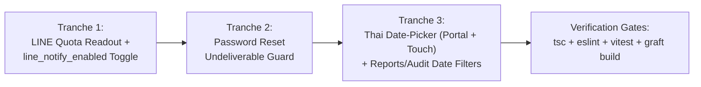

# PRP-Plan — แผนการดำเนินงานพอร์ตฟีเจอร์จาก JSK-App (Tranche 1–3)

**Branch:** `feat/jsk-port-quota-datepicker`  
**PRD:** `docs/plans/jsk-port-quota-datepicker-PRD.md`

---

## 1. ลำดับการพัฒนา (Tranche Grouping & Dependency Order)

แบ่งงานออกเป็น **3 Tranches** ที่แยกอิสระต่อกันและตรวจสอบผลลัพธ์ทีละส่วนได้:

---

## 2. รายละเอียดการแก้ไขระดับไฟล์ (File-Level Changes)

### Tranche 1: LINE Quota Readout + `line_notify_enabled` Toggle (JSK PR #280, #281)

1. **[Modify] `src/lib/line/client.ts`**
   - เพิ่มฟังก์ชัน `getLineMessageQuota()` เรียก `GET /v2/bot/message/quota` และ `GET /v2/bot/message/quota/consumption`
   - ห่อด้วย `withLineCircuit('/message/quota', ...)` แยกต่างหากจาก `/message/push` เพื่อไม่ให้การเช็คโควต้าล้มไปเปิดวงจรของส่งข้อความ (หรือในทางกลับกัน)
   - คำนวณค่า `remaining = Math.max(0, limit - used)` (clamp ไม่ให้ติดลบตาม PR #281)
2. **[Create] `src/lib/line/quota.ts` & `src/lib/line/quota.test.ts`**
   - จัดการแคชโควต้าในหน่วยความจำระดับโปรเซส (TTL 5 นาที) พร้อมฟังก์ชัน `fetchLineQuota({ forceRefresh?: boolean })` และ `clearLineQuotaCache()`
   - ฟังก์ชัน `describeLineQuota(q)` คืนข้อความภาษาไทย เช่น `"โควต้า LINE คงเหลือ 450 / 500 ข้อความ"` หรือ `"ไม่จำกัด"`
3. **[Modify] `src/lib/line/settings.ts`**
   - เพิ่ม `line_notify_enabled: boolean` ใน `ChatSettingsDefaults` (ค่าเริ่มต้น `true` เพื่อไม่ให้กระทบการทำงานเดิม แต่แอดมินกดปิดได้ตลอดเวลา) และรองรับใน `normalizeSetting`
4. **[Modify] `src/app/api/line/admin/settings/route.ts`**
   - เพิ่ม `line_notify_enabled: z.boolean().optional()` ใน `settingsSchema` และส่งค่าออกใน `GET /api/line/admin/settings`
5. **[Create] `src/app/api/line/admin/quota/route.ts` & `src/app/api/line/admin/quota/route.test.ts`**
   - `GET /api/line/admin/quota` (ตรวจสิทธิ์ `requireStaffApi(ADMIN_ROLES)`) รองรับ `?refresh=1` คืนข้อมูลโควต้า หรือคืน 502 พร้อมข้อความภาษาไทยเมื่อ LINE API ขัดข้อง
6. **[Modify] `src/app/admin/_lib/admin-api.ts` & `src/app/admin/settings/settings-client.tsx` (+ `settings-client.test.tsx`)**
   - เพิ่ม `getLineQuota(refresh?: boolean)` ใน `adminApi`
   - ใน `SettingsClient`: แสดงยอดโควต้า LINE คงเหลือ + ปุ่ม "รีเฟรชโควต้า" ในการ์ด `สถานะ LINE Channel` และเพิ่มสวิตช์ `"ส่งแจ้งเตือนสถานะเรื่องทาง LINE"` (`line_notify_enabled`) ในการ์ด `พฤติกรรมบอท`

---

### Tranche 2: Password Reset Undeliverable Guard (JSK PR #284)

1. **[Modify] `src/lib/mail.ts`**
   - เพิ่มและ export ฟังก์ชัน `isMailDeliverable(): boolean` คืนค่า `true` เมื่อ `process.env.MAIL_CONSOLE === 'true' || Boolean(process.env.SMTP_HOST)`
2. **[Modify] `src/app/admin/actions/reset.ts` (+ อัปเดตเทสต์)**
   - ใน `requestPasswordReset`: ก่อนเรียก `createResetToken(user.id)` ให้เช็ค `isMailDeliverable()` ก่อน หากส่งเมลไม่ได้ ให้ไม่สร้าง Token ใหม่ (เพื่อไม่ให้เผา Token เก่าทิ้งโดยเปล่าประโยชน์) บันทึก `logAudit` ด้วย `PASSWORD_RESET_FAILURE` (`metadata: { reason: 'mail_not_configured' }`) และคืน `{ error: null, success: true }` ตามหลัก anti-enumeration

---

### Tranche 3: Shared Thai Date-Picker & Date Filters (JSK PR #285, #287)

1. **[Modify] `src/lib/thai-date.ts` (+ `src/lib/thai-date.test.ts`)**
   - เพิ่ม helper แปลง `YYYY-MM-DD` เป็นช่วงเวลาเริ่มต้น/สิ้นสุดของวันตามเขตเวลาไทย (`Asia/Bangkok`, `+07:00`): `parseThaiDateStart(isoDate: string): Date | null` และ `parseThaiDateEnd(isoDate: string): Date | null`
2. **[Create] `src/components/ui/thai-date-picker.tsx` & `src/components/ui/thai-date-picker.test.tsx`**
   - คอมโพเนนต์เลือกวันที่แสดงปี พ.ศ. ไทย (เช่น `23 ต.ค. 2569`)
   - ป๊อปอัพปฏิทินเรนเดอร์ผ่าน `createPortal(..., document.body)` พร้อมคำนวณตำแหน่งและกันหลุดขอบจอ (Collision handling) เพื่อไม่ให้ถูก `.glass-panel.overflow-hidden` ตัดขอบ
   - ปุ่มล้างค่า (X) ขนาด 32×32px (`h-8 w-8`) แยกเป็นปุ่มพี่น้องด้านข้างไอคอนปฏิทิน รองรับทั้งเมาส์และหน้าจอสัมผัส (`pointer:coarse`)
   - ความกว้างรองรับมือถือ `w-full sm:w-52`
3. **[Modify] `src/components/admin/case-filter-bar.tsx` & `src/app/admin/reports/page.tsx`**
   - เพิ่มช่องกรอง `ตั้งแต่วันที่` (`from`) และ `ถึงวันที่` (`to`) ด้วย `ThaiDatePicker`
   - ใน `src/app/admin/reports/page.tsx` กรอง `cases.createdAt >= fromStart` และ `cases.createdAt <= toEnd`
4. **[Modify] `src/app/admin/audit/audit-filter-bar.tsx` & `src/app/admin/audit/page.tsx`**
   - เพิ่มช่องกรอง `ตั้งแต่วันที่` (`from`) และ `ถึงวันที่` (`to`) ด้วย `ThaiDatePicker`
   - ใน `src/app/admin/audit/page.tsx` กรอง `auditLogs.createdAt >= fromStart` และ `auditLogs.createdAt <= toEnd`

---

## 3. กลยุทธ์การทดสอบ (Test Strategy per Unit)

- **Tranche 1:**
  - `src/lib/line/quota.test.ts`: ทดสอบการดึงโควต้าปกติ, โควต้าไม่จำกัด (`none`), กรณีใช้เกินลิมิตต้องไม่ติดลบ (`remaining = 0`), แคช 5 นาที, `forceRefresh`, และกรณี LINE API ล่ม
  - `src/app/admin/settings/settings-client.test.tsx`: ทดสอบการแสดงผลโควต้า ปุ่มรีเฟรช และสวิตช์ `line_notify_enabled`
- **Tranche 2:**
  - ทดสอบ `isMailDeliverable()` และทดสอบว่าเมื่อไม่มี `SMTP_HOST` ระบบจะไม่เรียก `createResetToken`
- **Tranche 3:**
  - `src/lib/thai-date.test.ts`: ทดสอบ `parseThaiDateStart` / `parseThaiDateEnd` กับรูปแบบวันที่ถูกต้องและไม่ถูกต้อง
  - `src/components/ui/thai-date-picker.test.tsx`: ทดสอบการเปิดปฏิทินใน `document.body` (Portal), การเลือกวันที่แล้วได้ค่า `YYYY-MM-DD`, การแสดงผลปี พ.ศ., และการกดปุ่มล้างค่า (X)

---

## 4. ความเสี่ยงและการป้องกัน (Risk Areas & Mitigations)

| ความเสี่ยง | การป้องกัน |
|---|---|
| LINE Quota API ล่มแล้วไปทำให้ Circuit Breaker ของการส่งข้อความแชทพังไปด้วย | ใช้คีย์ Circuit Breaker แยกเฉพาะ `'/message/quota'` ไม่ปนกับ `'/message/push'` |
| ป๊อปอัพปฏิทินโดนขอบการ์ด `.glass-panel` ตัดแหว่ง | เรนเดอร์ป๊อปอัพผ่าน `createPortal` ที่ `document.body` พร้อม `z-50` และการคำนวณตำแหน่ง |
| เวลาที่กรองวันที่คลาดเคลื่อนเพราะ Timezone เซิร์ฟเวอร์เป็น UTC | แปลง `YYYY-MM-DD` โดยระบุโซนเวลา `+07:00` (`Asia/Bangkok`) เสมอใน `parseThaiDateStart` / `parseThaiDateEnd` |
